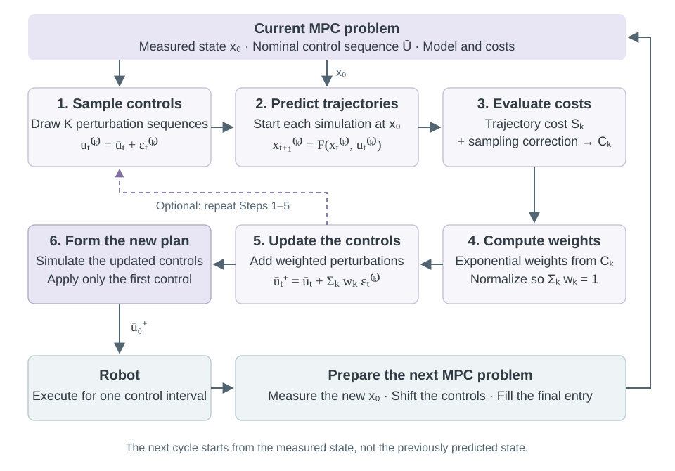
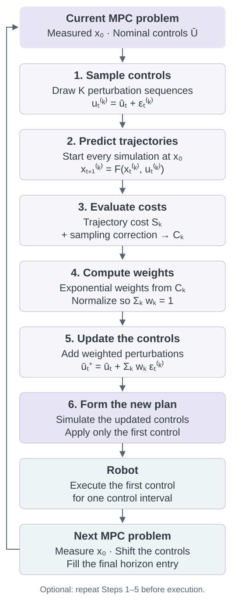

# Model Predictive Path Integral Control {#model-predictive-path-integral-control}

## System {#mppi-system}

Model predictive control (MPC) uses a system model to plan a robot's motion over a finite time horizon. It computes a sequence of control inputs and the state trajectory produced by those inputs. The robot executes the first input, and the planning problem is solved again from the next measured state.

Model Predictive Path Integral control (MPPI) is a sampling-based method for this trajectory optimization. It generates candidate trajectories by simulating the robot under perturbed control sequences, evaluates their costs, and updates the nominal control sequence using weighted samples. This chapter develops the algorithm in the MPC setting used by Williams et al. [@williams2017, Sec. V] and the discrete formulation of Kim et al. [@kim2022, Sec. II].

### System model

Consider the discrete-time system

\begin{equation}
x_{t+1}=F(x_t,u_t).
(\#eq:mppi-model)
\end{equation}

Here, \(x_t\in\mathbb R^n\) is the state, \(u_t\in\mathbb R^m\) is the control input, and \(F\) is the dynamics over one time step \(\Delta t>0\). This is the discrete counterpart of \(\dot x=f(x,u)\) in the [system modelling notes](#system-modelling). For example, forward Euler gives \(F(x,u)=x+\Delta t f(x,u)\).

At the beginning of a planning problem, \(x_0\) is the measured state. The prediction index is \(t=0,\ldots,H-1\), where \(H\) is the number of prediction steps. The prediction horizon has duration \(H\Delta t\). These indices are local to the current planning problem: at the next control cycle, the new measurement becomes \(x_0\).

A **control sequence** and its **state trajectory** are

\begin{equation}
U=(u_0,\ldots,u_{H-1}),\qquad X(U)=(x_0,x_1,\ldots,x_H).
\end{equation}

The notation \(X(U)\) makes the dependence on the controls explicit. Starting from \(x_0\), repeated application of \(F\) determines every predicted state. This forward simulation is also called a **rollout**. Each control sequence produces \(H+1\) states from \(H\) control inputs.

### The MPC problem

A finite-horizon control problem is

\begin{equation}
\begin{aligned}
\min_{U}\quad &J(U)=\phi(x_H)+\sum_{t=0}^{H-1}\left[c(x_t)+\frac12u_t^\top R_d u_t\right]\\
\text{s.t.}\quad &x_{t+1}=F(x_t,u_t),\qquad t=0,\ldots,H-1,\\
&u_t\in\mathcal U,\qquad x_0\text{ given}.
\end{aligned}
(\#eq:mppi-finite-objective)
\end{equation}

The scalar \(c(x_t)\) is a running state cost for one prediction step. It can penalize distance from a goal, tracking error, or proximity to an obstacle. The scalar \(\phi(x_H)\) is a terminal cost: it evaluates the state at the end of the prediction. The symmetric positive definite matrix \(R_d\in\mathbb R^{m\times m}\) weights control effort. The set \(\mathcal U\) contains the allowed inputs; without input limits, \(\mathcal U=\mathbb R^m\).

If a continuous running state cost \(\ell(x)\) is measured per second, its discrete contribution is \(c(x)=\Delta t\,\ell(x)\). The terminal cost is added once and is not multiplied by \(\Delta t\).

MPC uses this problem to plan motion while accounting for the predicted effect of the controls. For a mobile robot, this may mean reaching a goal while avoiding obstacles. For a pendulum, it may mean building momentum over several steps to reach the upright state. Both tasks require a state trajectory, rather than an isolated choice of the next input.

After computing a plan, MPC applies only its first control. The next measurement is used to solve a new planning problem. This repeated measurement, planning, and execution is the **receding-horizon** procedure described in the Williams papers [@williams2015, Sec. IV; @williams2017, Sec. V].

MPPI supplies the sampling-based trajectory update inside this procedure. The derivation below specifies the associated probability objective and its relation to the quadratic control cost. A finite MPPI update is an approximation; it is not an exact solver for every constrained version of Equation \@ref(eq:mppi-finite-objective).

---

## Preliminaries {#mppi-preliminaries}

### Notation

We use \(u\) for control inputs throughout. A bar distinguishes a **nominal** control from a sampled control. The nominal sequence \(\bar U=(\bar u_0,\ldots,\bar u_{H-1})\) is the current plan around which MPPI draws samples.

| Symbol | Meaning |
|:---|:---|
| \(x_0\) | Measured state at the start of the current planning problem |
| \(n,m\) | State and control dimensions |
| \(H,\Delta t\) | Number of prediction steps and duration of one step |
| \(t\) | Prediction index, \(0,\ldots,H-1\) |
| \(K,k\) | Number of sampled sequences and sample index \(k=1,\ldots,K\) |
| \(i\) | Optimization iteration at a fixed measured state |
| \(U,\bar U\) | A control sequence and the nominal control sequence |
| \(\epsilon_t^{(k)}\) | Perturbation of sample \(k\) at prediction step \(t\) |
| \(E^{(k)}\) | Perturbation sequence \((\epsilon_0^{(k)},\ldots,\epsilon_{H-1}^{(k)})\) |
| \(U^{(k)}=\bar U+E^{(k)}\) | A sampled control sequence |
| \(X^{(k)}=X(U^{(k)})\) | State trajectory generated by sample \(k\) |
| \(\Sigma\) | Positive definite reference covariance of control perturbations |
| \(\lambda>0\) | Temperature, with the same units as trajectory cost |
| \(S(U),C_k\) | State-trajectory cost and corrected score for sample \(k\) |
| \(w_k\) | Normalized weight of sample \(k\), with \(w_k\geq0\) and \(\sum_k w_k=1\) |

The superscript \(\top\) denotes transpose. For a symmetric positive definite matrix \(M\), \(z^\top Mz>0\) for every nonzero vector \(z\), and \(M^{-1}\) exists. We write \(\bar U^+\) for the result of one update and \(\bar U^i\) when several optimization iterations must be distinguished.

Kim et al. use \(U\) for the nominal sequence and \(V\) for sampled controls. Our notation uses \(\bar U\) and \(U\), respectively, so the input to the system remains \(u\). The paper's horizon \(T\) is written as \(H\) here.

### Gaussian sampling and expectations

A probability density \(p(z)\) is nonnegative and integrates to one. The probability that a random vector lies in a region is the integral of its density over that region.

A Gaussian vector with mean \(\mu\in\mathbb R^m\) and covariance \(\Sigma\) is written \(z\sim\mathcal N(\mu,\Sigma)\). Its density is

\begin{equation}
\mathcal N(z;\mu,\Sigma)=\frac{\exp[-\tfrac12(z-\mu)^\top\Sigma^{-1}(z-\mu)]}
{(2\pi)^{m/2}|\Sigma|^{1/2}},
\end{equation}

where \(|\Sigma|\) is the determinant. The mean is \(\mathbb E[z]\), and the covariance is \(\mathbb E[(z-\mu)(z-\mu)^\top]\). For a diagonal covariance \(\Sigma=\operatorname{diag}(\sigma_1^2,\ldots,\sigma_m^2)\), the components are independent and \(\sigma_j\) is the standard deviation of component \(j\).

For a function \(h\), its expectation under \(p\) is

\begin{equation}
\mathbb E_p[h(z)]=\int h(z)p(z)\,dz.
\end{equation}

Independent samples \(z^{(1)},\ldots,z^{(K)}\) from \(p\) give the Monte Carlo approximation

\begin{equation}
\mathbb E_p[h(z)]\approx\frac1K\sum_{k=1}^{K}h(z^{(k)}).
\end{equation}

Thus an integral can be approximated by evaluating a function at sampled points and averaging the results. MPPI uses this operation with complete control sequences.

### Importance sampling

Sometimes the required expectation is under a density \(p\), but samples are drawn from another density \(q\). Provided \(q\) is positive wherever the integrand contributes,

\begin{equation}
\mathbb E_p[h(z)]=\mathbb E_q\!\left[h(z)\frac{p(z)}{q(z)}\right].
(\#eq:mppi-importance)
\end{equation}

The ratio \(p/q\) corrects for the change in the sampling distribution. It follows by multiplying the integrand \(h(z)p(z)\) by \(q(z)/q(z)\). This is the importance-sampling identity used in the MPPI derivation [@williams2015, Sec. III; @williams2017, Sec. III].

### Comparing probability distributions

For densities \(r\) and \(p\), the Kullback--Leibler divergence is

\begin{equation}
D_{\mathrm{KL}}(r\|p)=\int r(z)\log\frac{r(z)}{p(z)}\,dz.
\end{equation}

It is nonnegative and is zero when the two densities agree almost everywhere. The order matters: \(D_{\mathrm{KL}}(r\|p)\) and \(D_{\mathrm{KL}}(p\|r)\) generally differ. We will use the first to define a distribution over low-cost trajectories, and then use a second minimization to obtain the nominal controls. Both steps are developed explicitly below.

---

## Method: MPPI {#mppi-method}

### Algorithm {#mppi-algorithm}

MPPI maintains a nominal control sequence, generates trajectories around it, and updates the sequence from their costs. The state trajectories are generated through the system dynamics, so each candidate has a corresponding control sequence.

The following algorithm uses independent Gaussian perturbations with covariance \(\Sigma\) and no input bounds. These choices give the basic MPPI update in Kim et al., Equations (1)--(10). Input bounds and a different sampling covariance are treated after the individual components.

**Given:** the measured state \(x_0\), nominal sequence \(\bar U\), model \(F\), costs \(c\) and \(\phi\), horizon \(H\), sample count \(K\), covariance \(\Sigma\), and temperature \(\lambda\).

1. **Sample control sequences.** For every \(k=1,\ldots,K\) and \(t=0,\ldots,H-1\), draw \(\epsilon_t^{(k)}\sim\mathcal N(0,\Sigma)\) independently and set \(u_t^{(k)}=\bar u_t+\epsilon_t^{(k)}\).
2. **Generate state trajectories.** Set \(x_0^{(k)}=x_0\) and simulate \(x_{t+1}^{(k)}=F(x_t^{(k)},u_t^{(k)})\). This produces \(K\) candidate robot trajectories.
3. **Evaluate each trajectory.** Compute the state cost and the sampling correction:

   \[
   S_k=\phi(x_H^{(k)})+\sum_{t=0}^{H-1}c(x_t^{(k)}),\qquad
   C_k=S_k+\lambda\sum_{t=0}^{H-1}\bar u_t^\top\Sigma^{-1}\epsilon_t^{(k)}.
   \]

4. **Compute the weights.** Set \(\beta=\min_k C_k\) and

   \[
   w_k=\frac{\exp[-(C_k-\beta)/\lambda]}{\sum_{j=1}^{K}\exp[-(C_j-\beta)/\lambda]}.
   \]

5. **Update the nominal controls.** For every prediction step, compute

   \[
   \bar u_t^+=\bar u_t+\sum_{k=1}^{K}w_k\epsilon_t^{(k)}.
   \]

6. **Form the updated plan and execute the MPC step.** Simulate \(\bar U^+\) from \(x_0\) to obtain its predicted trajectory. Apply \(\bar u_0^+\) to the robot for one control interval. Shift the remaining controls forward, append a final control, and use the next measured state to begin again.

Steps 1--5 can be repeated with fresh perturbations before Step 6. During those optimization iterations, \(x_0\) stays fixed and the updated sequence becomes the next nominal sequence. The shift is performed only after an input has been applied to the robot.

The algorithm produces an updated control sequence and its predicted state trajectory. The new trajectory is obtained by simulating the updated controls; it is generally different from a weighted average of the sampled state trajectories.

### Block diagram {#mppi-block-diagram}

<figure class="mppi-diagram">

<figcaption>One MPPI update inside the MPC loop. The numbered blocks correspond to the algorithm above. The model is used to predict trajectories; the robot receives only the first control of the updated plan.</figcaption>
</figure>

The following sections explain each block in the same order.

### 1. Sampling the control sequences {#mppi-sampling}

The nominal sequence \(\bar U\) is the center of the search. At the first control cycle it must be initialized, for example to zero. At later cycles it comes from the unexecuted part of the previous plan, as in the receding-horizon algorithms of Williams et al.

The reference distribution is

\begin{equation}
p(U)=\prod_{t=0}^{H-1}\mathcal N(u_t;0,\Sigma).
(\#eq:mppi-prior)
\end{equation}

It assigns a density to complete control sequences before accounting for the trajectory cost. The distribution used to draw samples is

\begin{equation}
q_{\bar U}(U)=\prod_{t=0}^{H-1}\mathcal N(u_t;\bar u_t,\Sigma),\qquad
u_t=\bar u_t+\epsilon_t.
(\#eq:mppi-proposal)
\end{equation}

The subscript \(\bar U\) identifies the mean sequence. The argument \(U\) is a possible sampled sequence. The product follows from independence across prediction steps. Both densities use the same covariance in the basic algorithm [@kim2022, Sec. II].

For diagonal \(\Sigma\), one sample is generated by drawing independent standard normal entries in \(\xi_t^{(k)}\in\mathbb R^m\) and setting

\begin{equation}
\epsilon_t^{(k)}=\operatorname{diag}(\sigma_1,\ldots,\sigma_m)\xi_t^{(k)}.
\end{equation}

Every candidate is generated from the same \(\bar U\). The nominal sequence is updated only after the entire batch has been evaluated. The perturbations explore alternative controls; they do not, by themselves, represent physical disturbances acting on the robot.

### 2. Generating robot trajectories {#mppi-trajectories}

For each sampled sequence, the model is propagated forward:

\begin{equation}
x_0^{(k)}=x_0,\qquad
x_{t+1}^{(k)}=F(x_t^{(k)},u_t^{(k)}).
\end{equation}

This step converts a sampled control sequence into a state trajectory. The states within one trajectory must be computed in time order, because \(x_{t+1}^{(k)}\) depends on \(x_t^{(k)}\). Different candidate trajectories can be simulated independently. This is the parallel computation used in Williams et al., Section V.

**Example: Double-integrator trajectories**

Let \(p_t\in\mathbb R^2\) be position, \(v_t\in\mathbb R^2\) velocity, and \(u_t\in\mathbb R^2\) the acceleration input. The state is \(x_t=(p_t,v_t)\). Holding the input constant over \(\Delta t\) gives

\begin{equation}
p_{t+1}=p_t+\Delta t\,v_t+\tfrac12\Delta t^2u_t,\qquad
v_{t+1}=v_t+\Delta t\,u_t.
\end{equation}

Each sampled acceleration sequence therefore produces a sequence of positions and velocities. Changing a control early in the horizon changes several later states. This example uses the double-integrator model from the [dynamic models notes](#different-dynamic-models).

### 3. Evaluating the trajectories {#mppi-costs}

The state-trajectory cost is

\begin{equation}
S(U)=\phi(x_H)+\sum_{t=0}^{H-1}c(x_t),\qquad x_{t+1}=F(x_t,u_t).
(\#eq:mppi-state-cost)
\end{equation}

It evaluates the motion produced by \(U\). A goal-reaching task may assign high costs to large position error or proximity to an obstacle. The terminal cost evaluates where the predicted trajectory ends. This is the cost in Kim et al., Equation (4).

The algorithm uses a corrected score \(C_k\), not just \(S(U^{(k)})\). To derive it, we first specify the distribution that MPPI is approximating.

#### The target distribution

Define

\begin{equation}
q^\star(U)=\frac1Z\exp[-S(U)/\lambda]p(U),\qquad
Z=\int\exp[-S(U)/\lambda]p(U)\,dU.
(\#eq:mppi-target)
\end{equation}

Here \(0<Z<\infty\), and the integral is over all \(mH\) control coordinates. The factor \(Z\) makes the density integrate to one. A lower trajectory cost increases the factor \(\exp[-S(U)/\lambda]\). The reference density \(p\) also affects which control sequences receive substantial probability [@kim2022, Eq. (3)].

This distribution solves a precise optimization problem. For any admissible density \(r\), use

\begin{equation}
\log\frac{q^\star(U)}{p(U)}=-\frac{S(U)}\lambda-\log Z
\end{equation}

to obtain

\begin{equation}
\mathbb E_r[S]+\lambda D_{\mathrm{KL}}(r\|p)
=-\lambda\log Z+\lambda D_{\mathrm{KL}}(r\|q^\star).
(\#eq:mppi-variational)
\end{equation}

The last divergence is nonnegative and vanishes at \(r=q^\star\). Thus the target minimizes expected state-trajectory cost plus a penalty for changing the reference distribution. The scalar \(-\lambda\log Z\) is the minimum value, often called free energy in this formulation.

For the fixed-covariance Gaussian family in Equation \@ref(eq:mppi-proposal),

\begin{equation}
\lambda D_{\mathrm{KL}}(q_{\bar U}\|p)
=\frac\lambda2\sum_{t=0}^{H-1}\bar u_t^\top\Sigma^{-1}\bar u_t.
(\#eq:mppi-input-penalty)
\end{equation}

This is the quadratic penalty on nominal controls associated with the reference distribution. Its discrete control-weight matrix is \(R_d=\lambda\Sigma^{-1}\). The remaining state cost is an expectation over perturbed controls. Consequently, this distribution objective is related to the MPC objective introduced above, but is not identical to evaluating that deterministic objective at one control sequence.

#### The sampling correction

Samples are drawn from \(q_{\bar U}\), whereas the desired averages are under \(q^\star\). The importance-sampling weight is proportional to

\begin{equation}
\frac{q^\star(U)}{q_{\bar U}(U)}
\propto\exp[-S(U)/\lambda]\frac{p(U)}{q_{\bar U}(U)}.
\end{equation}

For one prediction step, the equal-covariance Gaussian normalizations cancel:

\begin{equation}
\log\frac{\mathcal N(u_t;0,\Sigma)}{\mathcal N(u_t;\bar u_t,\Sigma)}
=-\frac12u_t^\top\Sigma^{-1}u_t
+\frac12(u_t-\bar u_t)^\top\Sigma^{-1}(u_t-\bar u_t).
\end{equation}

Substituting \(u_t=\bar u_t+\epsilon_t\) and expanding gives

\begin{equation}
\log\frac{\mathcal N(u_t;0,\Sigma)}{\mathcal N(u_t;\bar u_t,\Sigma)}
=-\frac12\bar u_t^\top\Sigma^{-1}\bar u_t
-\bar u_t^\top\Sigma^{-1}\epsilon_t.
\end{equation}

Adding over the horizon places the following terms inside the exponential cost:

\begin{equation}
S(U)+\frac\lambda2\sum_t\bar u_t^\top\Sigma^{-1}\bar u_t
+\lambda\sum_t\bar u_t^\top\Sigma^{-1}\epsilon_t.
\end{equation}

The nominal-only term is identical for every sample in the batch. It cancels when the weights are normalized. The score needed by the algorithm is therefore

\begin{equation}
C_k=S(U^{(k)})+\lambda\sum_{t=0}^{H-1}\bar u_t^\top\Sigma^{-1}\epsilon_t^{(k)}.
(\#eq:mppi-score)
\end{equation}

This is Kim et al., Equation (10), in the notation of this chapter. The correction accounts for sampling around \(\bar U\) instead of the zero-mean reference. It can be negative because it comes from a log density ratio. Omitting it generally changes the target distribution being estimated.

### 4. Computing the trajectory weights {#mppi-weighting}

The unnormalized weights are \(\exp(-C_k/\lambda)\). For numerical stability, subtract the lowest score \(\beta=\min_k C_k\):

\begin{equation}
\widetilde w_k=\exp[-(C_k-\beta)/\lambda],\qquad
w_k=\frac{\widetilde w_k}{\sum_{j=1}^{K}\widetilde w_j}.
(\#eq:mppi-weights)
\end{equation}

Subtracting \(\beta\) multiplies all unnormalized weights by the same factor. It therefore leaves the normalized weights unchanged. For finite scores, the largest exponential is one and all others are between zero and one. This avoids exponential overflow and prevents all weights from underflowing to zero simultaneously [@kim2022, Eq. (9)].

One weight is assigned to each complete sampled trajectory. That weight will be used at every prediction step of its control sequence. This is the whole-sequence estimator used in the discrete derivation here. Williams et al. also give feedback expressions involving costs-to-go from intermediate times; those expressions use a different starting point for the trajectory expectation.

### 5. Updating the nominal controls {#mppi-update-component}

The target density usually cannot be represented by a single Gaussian. MPPI approximates it with a Gaussian whose mean is adjustable and whose covariance is fixed. Let \(M=(m_0,\ldots,m_{H-1})\) denote a candidate mean sequence. Choose

\begin{equation}
M^\star=\arg\min_M D_{\mathrm{KL}}(q^\star\|q_M).
\end{equation}

After removing terms independent of \(M\), the objective is

\begin{equation}
\frac12\sum_{t=0}^{H-1}\mathbb E_{q^\star}
[(u_t-m_t)^\top\Sigma^{-1}(u_t-m_t)].
\end{equation}

Differentiating with respect to \(m_t\) gives \(\Sigma^{-1}(m_t-\mathbb E_{q^\star}[u_t])=0\). Hence

\begin{equation}
m_t^\star=\mathbb E_{q^\star}[u_t].
(\#eq:mppi-target-mean)
\end{equation}

The Gaussian mean should equal the target mean, provided that this first moment exists. This is the minimization in Kim et al., Equations (5)--(8). Its divergence direction differs from Equation \@ref(eq:mppi-variational); it is a Gaussian approximation to that target, rather than an exact minimization of the original MPC problem over control sequences.

Importance sampling gives

\begin{equation}
\mathbb E_{q^\star}[u_t]=
\frac{\mathbb E_{q_{\bar U}}[e^{-S(U)/\lambda}(p(U)/q_{\bar U}(U))u_t]}
{\mathbb E_{q_{\bar U}}[e^{-S(U)/\lambda}(p(U)/q_{\bar U}(U))]}.
(\#eq:mppi-ratio)
\end{equation}

The unknown normalization \(Z\) cancels. Approximating both expectations with the same sampled batch produces the update

\begin{equation}
\bar u_t^+=\sum_{k=1}^{K}w_k u_t^{(k)}
=\bar u_t+\sum_{k=1}^{K}w_k\epsilon_t^{(k)}.
(\#eq:mppi-update)
\end{equation}

The second equality follows from \(u_t^{(k)}=\bar u_t+\epsilon_t^{(k)}\) and \(\sum_k w_k=1\). The normalized finite-sample estimate is generally biased, although it is consistent under the usual integrability conditions as \(K\) grows.

**Example: One control update**

Let \(H=1\), \(\bar u_0=1\), \(\Sigma=1\), and \(\lambda=1\). Three perturbations \((-1,0,1)\) produce sampled controls \((0,1,2)\). Suppose their state costs are \((4,1,0)\).

Adding the correction in Equation \@ref(eq:mppi-score) gives scores \((3,1,1)\). The weights are

\begin{equation}
(w_1,w_2,w_3)=\frac{(e^{-2},1,1)}{e^{-2}+2}
\approx(0.0634,0.4683,0.4683).
\end{equation}

The updated control is \(\bar u_0^+=0w_1+1w_2+2w_3\approx1.405\). Weighting only by state cost would instead give approximately \(1.708\), which estimates a different target.

### 6. Updating the trajectory and advancing the horizon {#mppi-receding-horizon}

The updated plan is generated from the updated controls:

\begin{equation}
\bar x_0^+=x_0,\qquad
\bar x_{t+1}^+=F(\bar x_t^+,\bar u_t^+).
\end{equation}

For nonlinear dynamics, this trajectory need not equal \(\sum_k w_kX^{(k)}\). Re-simulating the updated sequence gives the trajectory that the model predicts for those controls. The implementation uses this simulation to display the plan.

The robot executes \(\bar u_0^+\). The remaining controls initialize the next optimization:

\begin{equation}
\bar U\leftarrow(\bar u_1^+,\ldots,\bar u_{H-1}^+,u_{\mathrm{init}}).
\end{equation}

Here \(u_{\mathrm{init}}\) fills the final horizon entry. The Williams algorithms specify an initialization rule for that entry. The companion code repeats the last planned control, so \(u_{\mathrm{init}}=\bar u_{H-1}^+\). This is an implementation choice.

After one control interval, the next measured state becomes \(x_0\). Every candidate in the next batch starts from that measurement. This closes the feedback loop and corrects the prediction as new measurements arrive.

### Changing the sampling covariance {#mppi-covariance}

Williams et al. change the sampling covariance to adjust exploration while correcting the resulting distribution change [@williams2015, Sec. III; @williams2017, Sec. III]. The discrete Gaussian calculation can be written explicitly.

Keep reference covariance \(\Sigma\), but sample with positive definite covariance \(\Sigma_s\):

\begin{equation}
p(U)=\prod_t\mathcal N(u_t;0,\Sigma),\qquad
q_{\bar U,\Sigma_s}(U)=\prod_t\mathcal N(u_t;\bar u_t,\Sigma_s).
\end{equation}

Expanding the log density ratio with \(u_t=\bar u_t+\epsilon_t\) gives

\begin{equation}
\begin{aligned}
\lambda\log\frac{q_{\bar U,\Sigma_s}(U)}{p(U)}
={}&\frac{\lambda H}{2}\log\frac{|\Sigma|}{|\Sigma_s|}
+\frac\lambda2\sum_t\bar u_t^\top\Sigma^{-1}\bar u_t\\
&+\lambda\sum_t\bar u_t^\top\Sigma^{-1}\epsilon_t
+\frac\lambda2\sum_t\epsilon_t^\top(\Sigma^{-1}-\Sigma_s^{-1})\epsilon_t.
\end{aligned}
\end{equation}

Both covariances are fixed throughout the batch. The determinant term and the nominal-only term are constant across samples and cancel in normalized weights. Therefore,

\begin{equation}
C_k=S(U^{(k)})+\lambda\sum_t\bar u_t^\top\Sigma^{-1}\epsilon_t^{(k)}
+\frac\lambda2\sum_t(\epsilon_t^{(k)})^\top(\Sigma^{-1}-\Sigma_s^{-1})\epsilon_t^{(k)}.
(\#eq:mppi-general-covariance)
\end{equation}

For a scalar variance multiplier \(\nu>0\), set \(\Sigma_s=\nu\Sigma\). Then

\begin{equation}
C_k=S(U^{(k)})+\lambda\sum_t\bar u_t^\top\Sigma^{-1}\epsilon_t^{(k)}
+\frac\lambda2(1-\nu^{-1})\sum_t(\epsilon_t^{(k)})^\top\Sigma^{-1}\epsilon_t^{(k)}.
(\#eq:mppi-covariance-score)
\end{equation}

The sampled standard deviations are multiplied by \(\sqrt\nu\). Setting \(\nu=1\) recovers the basic score. Changing \(\nu\) changes where samples are drawn while retaining the same target; changing \(\Sigma\) changes the reference distribution and therefore the target.

State-dependent covariance or noise correlated across prediction steps requires the corresponding full density ratio. Terms that cancel in the calculation above may then depend on the sampled trajectory.

### Input bounds and obstacles {#mppi-bounds}

A Gaussian has unbounded support. To handle bounded inputs while retaining the Gaussian density calculation, distinguish the raw sample \(\tilde u_t\) from the input \(u_t\) supplied to the model:

\begin{equation}
\tilde u_t^{(k)}=\bar u_t+\epsilon_t^{(k)},\qquad
u_t^{(k)}=g(\tilde u_t^{(k)}),\qquad
 g(v)=\operatorname{clip}(v,u_{\min},u_{\max}).
\end{equation}

The vectors \(u_{\min}\) and \(u_{\max}\) specify componentwise actuator limits. The clipping map limits each component to its allowed interval. All rollouts use \(x_{t+1}=F(x_t,g(\tilde u_t))\).

The reference and proposal densities are now densities of the raw sequence \(\tilde U\). Its state cost is obtained by simulating the clipped inputs. The update still uses raw perturbations to update \(\bar U\), and the applied control is \(g(\bar u_0^+)\). Here \(\bar U\) is the nominal sequence before clipping; its entries may lie outside the actuator limits.

This is the bounded variant used in the companion implementation. It keeps the density ratio consistent with the sampled variables. In particular,

\begin{equation}
g\!\left(\sum_k w_k\tilde u_t^{(k)}\right)
\neq\sum_k w_k g(\tilde u_t^{(k)})
\end{equation}

in general. Averaging clipped controls, or replacing the Gaussian perturbation by \(g(\bar u_t+\epsilon_t)-\bar u_t\), changes the calculation. Kim et al., Section III.A, discuss clamping and bounded perturbations; the distinction above states the particular choice made in this tutorial.

Obstacle costs affect which trajectories receive weight. A finite penalty discourages collision but does not enforce a hard state constraint. Moreover, two sampled trajectories can pass on opposite sides of an obstacle while their averaged controls generate a trajectory through it. This is another reason to simulate the updated plan itself. The examples report clearance along segments between executed positions; this diagnostic is not a proof of continuous-time safety.

### Smooth MPPI {#smooth-mppi}

Kim et al. introduce SMPPI to reduce rapid changes in control inputs [@kim2022, Sec. III.B]. The method maintains a physical control sequence and samples in coordinates with units of control per second. We keep \(u\) for the physical input and use \(d\) for these derivative coordinates.

At optimization iteration \(i\), let \(\bar U^i\) be the nominal physical control sequence and \(\bar D^i=(\bar d_0^i,\ldots,\bar d_{H-1}^i)\) the derivative-coordinate mean. Sample

\begin{equation}
d_t^{(k)}=\bar d_t^i+\epsilon_t^{(k)},\qquad
u_t^{(k)}=\bar u_t^i+\Delta t\,d_t^{(k)},\qquad
\epsilon_t^{(k)}\sim\mathcal N(0,\Sigma_d).
(\#eq:mppi-smooth-samples)
\end{equation}

The positive definite covariance \(\Sigma_d\) is measured in derivative coordinates. This equation modifies each entry of the stored control sequence during an optimization iteration. It is not the time recurrence \(u_t=u_{t-1}+\Delta t d_t\). The prediction index \(t\) and optimization iteration \(i\) have different roles in the paper's Equations (16)--(18).

To penalize differences between adjacent physical controls, define

\begin{equation}
\Omega(U)=\sum_{t=1}^{H-1}(u_t-u_{t-1})^\top W_u(u_t-u_{t-1}).
(\#eq:mppi-smooth-cost)
\end{equation}

The matrix \(W_u\in\mathbb R^{m\times m}\) is symmetric positive semidefinite, meaning \(z^\top W_u z\geq0\) for every \(z\). Kim et al. use a diagonal weight matrix. The penalty is evaluated on each candidate control sequence during optimization.

Let \(S_{\bar U^i}(D)\) be the state cost obtained by simulating \(\bar U^i+\Delta t D\). For equal reference and sampling covariances in derivative coordinates, the corrected score is

\begin{equation}
C_k=S_{\bar U^i}(D^{(k)})+\Omega(\bar U^i+\Delta t D^{(k)})
+\lambda\sum_t(\bar d_t^i)^\top\Sigma_d^{-1}\epsilon_t^{(k)}.
(\#eq:mppi-smooth-score)
\end{equation}

After normalizing the weights, update

\begin{equation}
\bar d_t^{i+1}=\bar d_t^i+\sum_k w_k\epsilon_t^{(k)},\qquad
\bar u_t^{i+1}=\bar u_t^i+\Delta t\,\bar d_t^{i+1}.
(\#eq:mppi-smooth-update)
\end{equation}

These are the paper's Equations (15)--(18), with \(u\) reserved for physical controls and \(d\) for derivative coordinates. The physical input to the robot remains \(u\).

The implementation clips physical controls in both the candidate rollout and the difference penalty, retains raw derivative perturbations for the density ratio, and clips the updated physical sequence. When the sampling covariance is \(\nu\Sigma_d\), it also includes the covariance correction derived above. These choices specify the implemented bounded variant.

The difference penalty starts at prediction step one. It does not include the previously executed control, and it does not impose a hard bound on the rate of change of the input. Both stored sequences are shifted once after a physical control interval.

### Parameters and finite-sample behavior {#mppi-parameters}

| Parameter | Role |
|:---|:---|
| \(H\) | Determines how far the model predicts; the relevant maneuver must fit within the prediction horizon |
| \(K\) | Determines how many candidate trajectories are evaluated in one update |
| \(\lambda\) | Sets the relative influence of state cost and the reference distribution in \(q^\star\) |
| \(\Sigma\) | Sets reference control spread and the associated nominal-control penalty |
| \(\nu\) | Changes sampling covariance without changing the reference distribution |
| Number of updates | Determines how many sampling and update iterations are performed before execution |
| \(W_u\) | Weights adjacent-control differences in SMPPI |

For fixed scores, \(w_j/w_k=\exp[-(C_j-C_k)/\lambda]\). However, the score correction also contains \(\lambda\), so changing temperature changes more than the exponential normalization.

The implementation reports the effective sample size

\begin{equation}
N_{\mathrm{eff}}=\frac1{\sum_{k=1}^{K}w_k^2}.
\end{equation}

It equals \(K\) for uniform weights and approaches one when a single sample dominates. This is a diagnostic calculated from the weights. It does not establish that the sampled trajectories are useful or that the updated plan is safe.

A finite sample update need not decrease the deterministic trajectory cost. A single Gaussian mean can also represent separated groups of good controls poorly, such as trajectories going around opposite sides of an obstacle. Increasing the sample count improves estimation; it does not remove this limitation of the mean representation.

### Connection to continuous-time path-integral control {#mppi-continuous-time}

The algorithm above uses a distribution over discrete control sequences. The two Williams papers derive path-integral control from a continuous-time stochastic optimal-control problem. This section gives that connection after the sampling algorithm has been established.

#### Stochastic dynamics and expected cost

Use \(s\) for continuous time and \(T_f\) for final time. The original dynamics are

\begin{equation}
dx_s=\big[f(x_s,s)+G(x_s,s)u_s\big]ds+B(x_s,s)\,d\mathcal W_s.
(\#eq:mppi-stochastic-dynamics)
\end{equation}

The matrices \(G\in\mathbb R^{n\times m}\) and \(B\in\mathbb R^{n\times d}\) map control and random disturbance into changes of state. The process \(\mathcal W_s\in\mathbb R^d\) is Brownian motion, and \(I_d\) is the \(d\times d\) identity matrix. A Brownian increment satisfies \(\mathcal W_{s+\Delta t}-\mathcal W_s\sim\mathcal N(0,\Delta t I_d)\), with independent increments on disjoint intervals. Thus a time-discretized disturbance has size proportional to \(\sqrt{\Delta t}\), not \(\Delta t\).

The value function \(W(x,s)\) is the least expected remaining cost from state \(x\) at time \(s\):

\begin{equation}
W(x,s)=\inf_u\mathbb E\!\left[
\phi(x_{T_f})+\int_s^{T_f}\left(\ell(x_\tau,\tau)
+\tfrac12u_\tau^\top R(x_\tau,\tau)u_\tau\right)d\tau
\;\middle|\;x_s=x\right].
\end{equation}

Here \(R\) is positive definite, \(\ell\) is a running state cost per second, and the infimum is over admissible feedback controls. This is Williams et al. (2017), Equations (1)--(3).

#### The local optimality equation

The principle is to minimize the expected cost over a short first interval plus the best remaining cost afterward. Let \(W_x\) be the column vector of first state derivatives, \(W_{xx}\) the matrix of second state derivatives, and \(W_s\) the time derivative. A second-order expansion of the expected remaining value gives

\begin{equation}
\mathbb E[dW]=\left[W_s+(f+Gu)^\top W_x
+\tfrac12\operatorname{tr}(BB^\top W_{xx})\right]ds.
\end{equation}

The trace \(\operatorname{tr}(M)\) is the sum of a square matrix's diagonal entries. The second-derivative term remains because the disturbance covariance is \(BB^\top ds\). This is the local expectation rule needed here from stochastic calculus.

Equating the optimal short-interval change to zero gives the Hamilton--Jacobi--Bellman equation:

\begin{equation}
-W_s=\min_u\left[\ell+\tfrac12u^\top Ru+(f+Gu)^\top W_x
+\tfrac12\operatorname{tr}(BB^\top W_{xx})\right],
\qquad W(x,T_f)=\phi(x).
\end{equation}

For an unconstrained input, differentiating its quadratic expression gives

\begin{equation}
u^\star=-R^{-1}G^\top W_x.
\end{equation}

Substituting this minimizer back yields

\begin{equation}
-W_s=\ell+f^\top W_x-\tfrac12W_x^\top GR^{-1}G^\top W_x
+\tfrac12\operatorname{tr}(BB^\top W_{xx}).
(\#eq:mppi-hjb)
\end{equation}

These formal calculations assume sufficient smoothness for the derivatives and expectations to exist. They explain the equation used by Williams et al.; they are not a claim that every nonsmooth obstacle cost has a classical differentiable value function.

#### The assumption that makes the equation linear

Define a positive function \(\Psi\) through \(W=-\lambda\log\Psi\). Then

\begin{equation}
W_s=-\frac\lambda\Psi\Psi_s,\qquad
W_x=-\frac\lambda\Psi\Psi_x,\qquad
W_{xx}=-\frac\lambda\Psi\Psi_{xx}
+\frac\lambda{\Psi^2}\Psi_x\Psi_x^\top.
\end{equation}

Substitution into Equation \@ref(eq:mppi-hjb) produces two terms quadratic in \(\Psi_x\). They cancel exactly when

\begin{equation}
BB^\top=\lambda GR^{-1}G^\top.
(\#eq:mppi-matching)
\end{equation}

The same substitution also gives \(u^\star=\lambda R^{-1}G^\top\Psi_x/\Psi\). Thus a spatial derivative of the trajectory expectation determines the optimal feedback input under these assumptions.

Under this **noise--control matching condition**, the remaining equation is linear in \(\Psi\):

\begin{equation}
\Psi_s=\frac\ell\lambda\Psi-f^\top\Psi_x
-\tfrac12\operatorname{tr}(BB^\top\Psi_{xx}),
\qquad \Psi(x,T_f)=e^{-\phi(x)/\lambda}.
\end{equation}

A linear backward equation of this form has an expectation representation, given by the Feynman--Kac formula:

\begin{equation}
\Psi(x,s)=\mathbb E_p\!\left[
\exp\!\left(-\frac1\lambda\left[\phi(x_{T_f})+
\int_s^{T_f}\ell(x_\tau,\tau)d\tau\right]\right)
\;\middle|\;x_s=x\right].
(\#eq:mppi-path-integral)
\end{equation}

The expectation is over trajectories of the **uncontrolled** diffusion \(dx=f\,ds+B\,d\mathcal W\). It integrates over possible paths, rather than over a single state. This is the path integral in the algorithm's name. Sampling forward trajectories approximates this expectation without solving a state-space partial differential equation on a grid. Williams et al. (2017), Section II, derive this transformation and the resulting control expressions.

The matching condition is restrictive: the disturbance must act in state directions that the control can influence, with an appropriate relationship to the control penalty. If it fails, this particular linearization does not follow. A controller can still use the discrete sampling construction for a general model \(F\); the original continuous-time optimality result cannot then be assumed.

#### Relating time step, covariance, and control penalty

Suppose noise enters through the same input channels as control. An Euler--Maruyama step can be written

\begin{equation}
x_{t+1}=x_t+f(x_t)\Delta t+G(x_t)(\bar u_t+\epsilon_t)\Delta t.
\end{equation}

To match Equation \@ref(eq:mppi-matching), the reference input perturbations satisfy

\begin{equation}
\operatorname{Cov}(\epsilon_t)=\Sigma
=\frac\lambda{\Delta t}R^{-1},
\qquad R\Delta t=\lambda\Sigma^{-1}.
\end{equation}

The factor \(1/\Delta t\) appears because an input acts for \(\Delta t\), while the Brownian increment covariance scales as \(\Delta t\). With proposal covariance \(\nu\Sigma\), the corrected per-step cost can be written

\begin{equation}
\Delta t\left[\ell(x_t)+\tfrac12\bar u_t^\top R\bar u_t
+\bar u_t^\top R\epsilon_t
+\tfrac12(1-\nu^{-1})\epsilon_t^\top R\epsilon_t\right].
\end{equation}

This is the special-case running cost in Williams et al. (2017), Section III.C. Removing the common mean-only term recovers Equation \@ref(eq:mppi-covariance-score). The tutorial uses the discrete input-density formulation; it does not claim that its chosen noise represents a physical Brownian process satisfying this matching condition.

---

## Implementation {#from-these-equations-to-the-implementation}

The [JAX implementation tutorial](https://kalebbennaveed.github.io/planning-algorithm-tutorial/mppi/) implements the blocks above with three toy systems: a double integrator, a unicycle, and a pendulum. Download the [uv project](https://kalebbennaveed.github.io/planning-algorithm-tutorial/mppi/jax-mppi-tutorial.zip) to run the examples and the local playground. The [Git repository](https://github.com/kalebbennaveed/planning-algorithms-library/tree/main/planning-algorithm-tutorial/mppi) is available to readers with repository access.

| Algorithm component | Implementation |
|:---|:---|
| System \(F(x,u)\), running state cost, terminal cost | `envs.py` |
| Nominal sequence \(\bar U\) before clipping | `mean` in basic MPPI |
| Sample perturbations and simulate trajectories | `update_with_noise`, `MPPI.rollout` in `core.py` |
| Corrected scores, Equation \@ref(eq:mppi-covariance-score) | `corrected_scores` |
| Normalized trajectory weights, Equation \@ref(eq:mppi-weights) | `normalized_weights` |
| Weighted control update, Equation \@ref(eq:mppi-update) | `update_with_noise` |
| Physical controls \(u_t\) after clipping | `actions` |
| Apply first control and shift the remaining sequence | `run_episode` in `demo.py` |
| SMPPI derivative mean \(\bar D\) and physical sequence \(\bar U\) | `mean` and `actions` in `mode="smppi"` |

The implementation uses `lax.scan` along each trajectory and `vmap` across candidate trajectories. The controls stored under the Python name `actions` are the inputs denoted by \(u\) in these notes.

The toy tasks and numerical parameters are teaching examples. Their recorded results include failures, so the examples can be used to inspect how the prediction horizon, sampling distribution, and costs affect the generated trajectories.

## Source guide {#mppi-source-guide}

The derivations above use these specific parts of the supplied papers:

- **Williams, Aldrich, and Theodorou (2015 preprint)**, *Model Predictive Path Integral Control using Covariance Variable Importance Sampling*, supplied as `1509.01149v3.pdf`: Section II for the stochastic control problem and path-integral representation; Section III for changing the sampling drift and diffusion; Section IV for the receding-horizon algorithm. [Supplied arXiv version](https://arxiv.org/abs/1509.01149v3).
- **Williams, Aldrich, and Theodorou (2017)**, *Model Predictive Path Integral Control: From Theory to Parallel Computation*: Section II, especially Equations (1)--(16), for the exponential value transformation and matching condition; Section III and Equations (33)--(34) for importance sampling and the weighted perturbation update; Section III.C for the covariance-scaled running cost; Section V and Algorithm 1 for parallel computation and MPC. [Journal article](https://doi.org/10.2514/1.G001921).
- **Kim, Park, Kwak, Bae, and Lee (2022; supplied arXiv v8)**, *Smooth Model Predictive Path Integral Control without Smoothing*: Section II, Equations (1)--(10), for discrete input densities, target distribution, and importance weights; Section III, Equations (11)--(18) and Algorithm 1, for bounded actions, smoothing, and the separate action sequence. [Supplied arXiv version](https://arxiv.org/abs/2112.09988v8), [journal article](https://doi.org/10.1109/LRA.2022.3192800).

The source papers motivate and derive the algorithms. The accompanying toy models, numerical parameters, browser interface, diagnostic checks, and tests are teaching additions, identified as such in the implementation tutorial.

## References {-}

