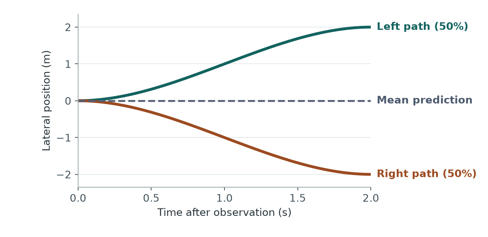

# Machine Learning Interview Prep {#machine-learning-interview-prep .ml-prep}

Imagine giving a car a short recording that ends just before a cyclist reaches an intersection. You can ask three questions about the next four seconds. **Where might the cyclist go? What should our car do? What would the car see if it braked now?** A model could answer the first question accurately and still give poor advice on the other two. This guide follows those questions from the first training example to the design of a research experiment.

## A route through the guide {#ml-study-route}

| Read | What to work out before moving on |
|:--|:--|
| [Learning from a driving log](#ml-first-example) | Fit one model parameter by hand. Explain what information the car has when it acts. |
| [Transformers and motion forecasting](#ml-transformers) | Calculate attention weights, draw a causal mask, and sample two drivers together. |
| [Reinforcement and imitation learning](#ml-reinforcement-learning) | Compute a return and a value update. Explain how a simulator can change the ranking of policies. |
| [Generative planning](#ml-generative-planning) | Train a denoiser on a path, generate proposals, and select an action under a compute budget. |
| [World models](#ml-world-models) | Roll a latent state forward under two actions. Design a test for a model that ignores steering. |
| [Choosing evaluation metrics](#ml-metrics) | Calculate trajectory error, calibration, and uncertainty. Choose a metric for a particular decision. |
| [Research scientist interview practice](#ml-interview-practice) | Work three technical exercises, give a paper critique, and defend a design in a timed mock interview. |

If you have a week, spend one session per row. With two weeks, use the second session on each topic to reproduce its worked example from memory and explain one paper aloud. For each paper, write down what the authors controlled, which result changes your mind, and one experiment that could reverse your conclusion. The exercises and interview prompts are original practice questions.

## Learning from a driving log {#ml-first-example}

A **log** records what happened on one drive. An **agent** is a participant such as a car or a cyclist. The **ego** vehicle is the one whose decisions we control. A **state** describes the relevant world at an instant. An **observation** contains the part the vehicle can measure. A cyclist behind a van may be in the state and absent from the observation. A **trajectory** is an ordered list of positions or states. An **action** such as acceleration changes the next state. Positions have units of metres, velocities metres per second, and accelerations metres per second squared.

Cut the log at time zero. The last second of observed positions, the current traffic signal, and nearby lane geometry form the input \(x\). A later recorded position \(y\) supplies the label during training. If an off-line tracker used future frames to smooth the positions in \(x\), a model can learn from information unavailable on the vehicle. Construct inputs using only data that would have arrived by the decision deadline. Keep clips from the same drive together when splitting training, validation and test data. Neighboring clips often show the very same intersection seconds apart.

### Fit a predictor with one number

Suppose a cyclist moves along a straight line and the last two observations imply a speed of 3 m/s. Our constant-velocity baseline predicts a displacement of 6 m over two seconds. Now try the simple model \(\hat y=w v\), where \(v\) is the observed speed and \(w\) is a trainable number initially equal to 2 seconds. If this cyclist travels only 4 m, the squared error is \(L=(6-4)^2=4\) square metres. Its derivative is \(2(wv-y)v=12\). With a learning rate of 0.05 in this toy parameterization, **gradient descent** updates \(w\) to \(2-0.05(12)=1.4\). The next prediction on this example is 4.2 m. A gradient tells us how a small parameter change affects loss locally.

Real training averages gradients over a **minibatch** of many examples. An **epoch** is a pass through the training set. A neural network replaces \(w\) with matrices and nonlinear functions, giving the model a way to use signals and lane shape. **Backpropagation** applies the chain rule through those functions. More parameters can lower training loss by memorizing individual drives. Use validation data to select settings such as learning rate or when to stop. Reserve independent test data for the final comparison. First check that the model can fit a tiny clean batch. Failure there is a reason to inspect units, labels, masks and gradients before scaling up.

### A probability is a prediction you can test

At an intersection, suppose the next lateral position is equally likely to be \(+2\) or \(-2\) m. The expected squared error of predicting a single number \(a\) is \(\tfrac12(a-2)^2+\tfrac12(a+2)^2=a^2+4\). It is smallest at zero, a position neither outcome occupies. A **multimodal** forecast can put probability on both outcomes. A **sample** draws one possible future from this distribution. A **mode** is a region of high probability density. Multiple sensor types are also called modalities, a different meaning of the word.

A model assigning probability 0.8 to “yield” incurs a **negative log-likelihood** of \(-\ln(0.8)=0.223\) if the cyclist yields and \(-\ln(0.2)=1.609\) if the cyclist goes. Averaging that loss over categorical labels gives **cross-entropy**. The larger penalty for a confident mistake encourages honest probabilities in expectation. A **conditional** probability \(p(y\mid x)\) changes with the observation \(x\). An **expectation** averages the possible values weighted by their probabilities. We will use both ideas to score forecasts and choose actions.

### Read the shapes before the architecture

A **scalar** is one number, a **vector** is an ordered list, and a **matrix** is a rectangular array. A **tensor** extends that idea to several axes. A batch of 16 scenes with space for 8 agents, 10 history steps and 4 measured features has shape \(16\times8\times10\times4\). A validity mask records which entries were observed. A missing pedestrian and a pedestrian at the origin can otherwise become the same input. A **dot product** multiplies matching entries of two vectors and adds them. For example, \((1,2)\cdot(3,1)=5\). A matrix multiplication computes many such dot products at once.

### Three interfaces for the same intersection

| Task | Give the model | Ask for | Compare against |
|:--|:--|:--|:--|
| Forecasting | Observed histories and map | Weighted possible futures for other agents | What happened across held-out drives |
| Planning | Observations, route and constraints | An ego action or feasible path to execute | Outcomes after executing decisions |
| World modeling | History and proposed ego actions | A distribution of subsequent states or observations | Held-out transitions and responses to controlled changes |

**Check your understanding.** A researcher gives a forecaster tomorrow’s route of another driver. When is this legitimate? It is a valid *conditional forecasting experiment* if the question explicitly grants the route. An ordinary on-vehicle forecast needs route information that is actually available at inference. Write the input contract before interpreting the score.

## Find a paper by its research question {#ml-paper-index}

| Research question | Walkthroughs |
|:--|:--|
| How can attention combine road geometry and agent histories? | [Wayformer](#ml-wayformer) |
| How do interacting agents share one sampled future? Where should additional compute go? | [MotionLM](#ml-motionlm) and [Scaling Laws of Motion Forecasting and Planning](#ml-scaling-laws) |
| How do policies recover from their own mistakes? | [ChauffeurNet](#ml-chauffeurnet) and [RL fine-tuning for simulated agents](#ml-rl-finetuning) |
| Can changing the other cars change the winner of a planner comparison? | [Waymax](#ml-waymax) and [the sim agents benchmark](#ml-sim-agents-metrics) |
| How can a generator follow a goal or reduce overlaps? | [Diffuser](#ml-diffuser-paper), [MotionDiffuser](#ml-motiondiffuser), and [hierarchical goal-conditioned imitation](#ml-hierarchical-planning) |
| Can a camera model produce usable plans? Can generated video test an existing planner? | [EMMA](#ml-emma) and [Drive&Gen](#ml-drive-gen) |
| How can a simulator react immediately and still populate a long trip? | [SceneDiffuser](#ml-scenediffuser) and [SceneDiffuser++](#ml-citysim) |

Continue with [Transformers and motion forecasting](#ml-transformers).
